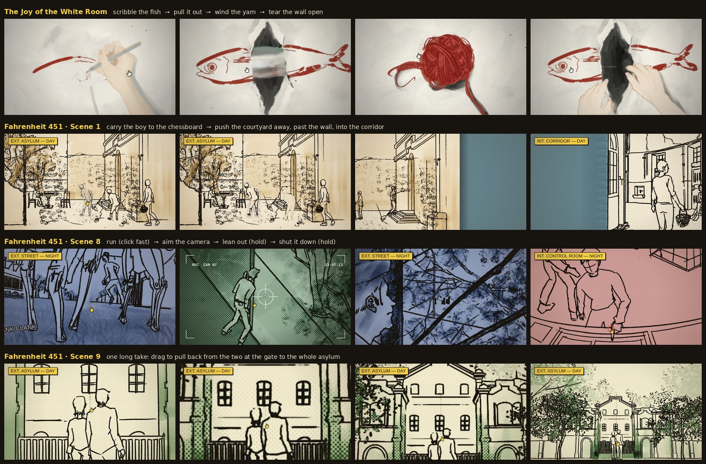
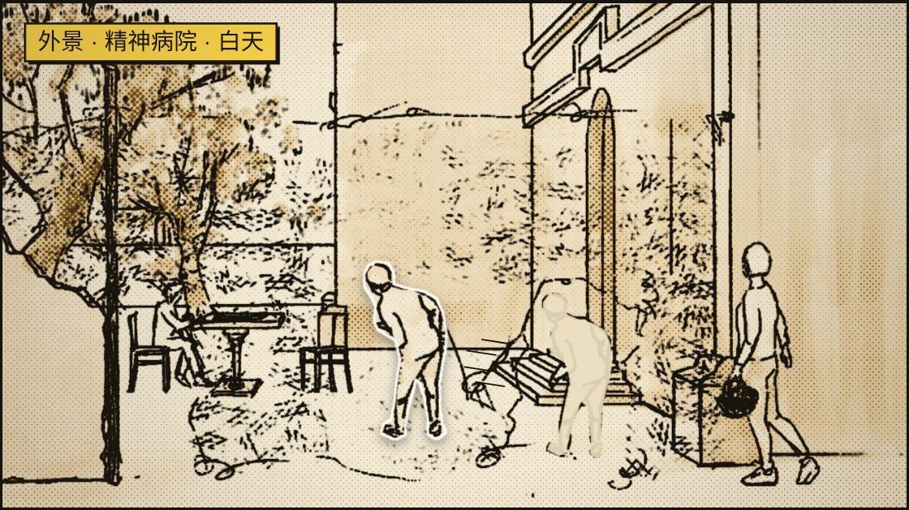
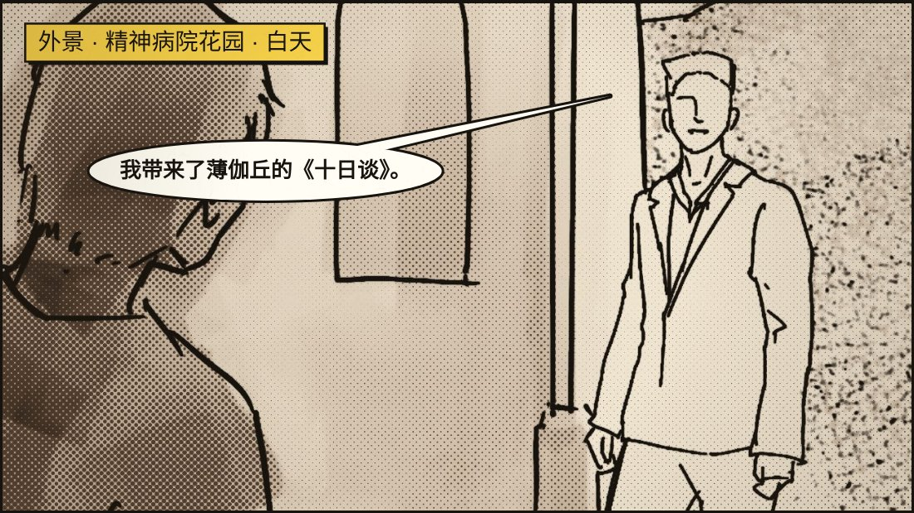

# interactive-storyboard

An **Agent Skill** that turns a drawn storyboard (a Storyboarder PDF or a folder of board images) into an **interactive visual story**: a single web page where the viewer moves the story on by clicking, holding and dragging on the drawings themselves, with sound, dialogue or captions, transitions and on-picture gesture guides.

It is made for people who already work with storyboards (boards, shots, slugs, notes). It does not redraw your work: it keeps your lines and gives them a look, a rhythm and interaction.

## What it does

- Reads your storyboard: crops the boards, reads notes, slugs and dialogue.
- Finds long takes and close→wide moves, and builds them as continuous shots.
- Applies a look: **film / riso**, **American comic**, or **pixel** — or keeps your drawings as they are.
- Designs gestures that *are* the story action (run, hold your breath, climb, hand something over, turn a page), using cut-outs of your own drawings, never invented props.
- Quiet on-picture guides and clear hints, so viewers always know where and how to act.
- Recorded or synthesized sound, sound bridges, soft transitions with one hard cut for the shock.
- Only the languages you ask for, switchable live.
- Tests the whole story in a headless browser and hands you files for your own website.

## Install

The skill is the folder [`interactive-storyboard/`](interactive-storyboard/) (it contains `SKILL.md`). It follows the open **Agent Skills** (`SKILL.md`) format, so it works with AI tools that support it, for example:

- **Claude** (claude.ai / desktop): Settings → Capabilities → Skills → upload the `interactive-storyboard` folder as a zip.
- **Claude Code**: copy the folder to `~/.claude/skills/`.
- **Codex CLI and other tools**: copy the folder into the tool's skills directory (see its documentation).

The tool must be able to run code (process PDFs and images, write HTML, run a headless browser). Chat-only assistants can read the instructions but cannot build the result.

## Use

Attach your storyboard and say something like:

> Turn scene 1 of this storyboard into an interactive story, American comic look, dialogue only, synthesized sound, Italian and English.

The skill asks a few questions first (scenes, look, text, sound, languages, where it will live, credit line), then builds a first version for you to review.

## Examples

Made with this process by Ding Yilin, set designer:

| | |
|---|---|
|  |  |
| *The Joy of the White Room* — film / riso look | |
|  |  |
| *Fahrenheit 451*, scenes 1 and 9 — American comic look | |

Live:
- *The Joy of the White Room*: [project page](https://dingyilin.netlify.app/project.html?id=camera-bianca) · [play the story directly](https://dingyilin.netlify.app/story/camera-bianca/)
- *Fahrenheit 451*, scenes 1 → 8 → 9: [project page](https://dingyilin.netlify.app/project.html?id=fahrenheit-451) · [play the story directly](https://dingyilin.netlify.app/story/fahrenheit-451/)

On each project page, the story is under "Storyboard": click **Enter the story**.

The example images are © Ding Yilin, all rights reserved; they are not covered by the licence below.

## Licence

The skill text (`interactive-storyboard/SKILL.md`) is released under the MIT licence — see [`LICENSE`](LICENSE).

---

## 中文简介

一个 **Agent Skill**：把手绘分镜（Storyboarder 导出的 PDF 或分镜图片）变成可以互动的视觉故事网页。观众直接在画面上点击、按住、拖动来推进故事，配有声音、对白或字幕、转场和画面上的操作提示。保留你原本的线条，只加画风、节奏和交互。

适合本身会画分镜的人使用。安装方法见上文 Install；需要能运行代码的 AI 工具（Claude、Claude Code、Codex 等）。

在线案例：[《白色极乐》](https://dingyilin.netlify.app/project.html?id=camera-bianca)、[《华氏451》第 1、8、9 场](https://dingyilin.netlify.app/project.html?id=fahrenheit-451)，在项目页的 Storyboard 栏目点“进入故事”。

示例作品图片版权归丁依琳所有，不在 MIT 许可范围内。
